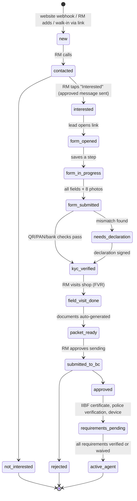

# Database Architecture

*Production design for the CSP onboarding platform. Built for many RMs now and for productising later: many organisations, many bank programmes. See [SECURITY.md](SECURITY.md) for how the data is protected.*

> **Viewing the diagrams:** they're written in Mermaid. GitHub/GitLab render them directly. In VS Code, install the "Markdown Preview Mermaid Support" extension and open the Markdown preview (`Ctrl+Shift+V`).

---

## 1. Design principles

| Principle | What it means in the schema |
|---|---|
| **Multi-tenant from day one** | Every business table has `org_id`. Postgres **Row-Level Security (RLS)** stops one organisation from ever seeing another's rows, even if the app has a bug. |
| **Multi-programme** | ESAF is one `program`. Another bank later is a new row, not a code change. Form questions, document templates and message templates belong to a programme. |
| **Multi-RM** | Leads have an `assigned_rm_id` and an assignment history. RLS limits an RM to their own leads; managers see their team's. |
| **PII encrypted at the column level** | Personal data (names, DOB, addresses, account numbers, phone numbers) is stored as `…_enc` (AES-256-GCM, encrypted by the app with keys from a key vault). A DB dump or a leaked backup shows ciphertext only. |
| **Searchable without decrypting** | Fields we must look up (mobile, PAN) also get a `…_hash` (HMAC-SHA256 "blind index") and a `…_last4` for display. |
| **Never store a full Aadhaar number** | Only `aadhaar_last4`, plus the UIDAI reference ID from the QR. Images are masked (see SECURITY.md). |
| **Append-only history** | `events` and `audit_log` are insert-only. Status changes, approvals and document views are recorded, never overwritten. `audit_log` is hash-chained so tampering is detectable. |
| **Soft delete + crypto-shred** | `deleted_at` for normal deletes. For DPDP erasure, destroy the lead's data key and every encrypted field and file becomes unreadable. |
| **IDs** | `uuid` primary keys generated with Postgres 18's `uuidv7()` (time-ordered, index-friendly, not guessable like 1, 2, 3). |
| **Schema changes through migrations** | Alembic migrations in git. No hand-run `ALTER TABLE`. |

---

## 2. Domain map

```
┌─────────────── A. Tenancy & Access ───────────────┐   ┌──────── G. Security & Compliance ────────┐
│ organizations  programs  teams  users             │   │ audit_log  retention_policies  data_keys │
│ user_sessions  user_channels                      │   └──────────────────────────────────────────┘
└───────────────────────┬───────────────────────────┘
                        │ assigns
┌───────────────────────▼───────────────────────────┐   ┌──────── E. Automation ───────────────────┐
│ B. Leads            leads   lead_assignments      │──▶│ events  approvals  notifications         │
└──────┬───────────────────┬────────────────────────┘   │ webhook_sources  webhook_deliveries      │
       │                   │                            └──────────────────────────────────────────┘
┌──────▼─────────────────────────────┐  ┌───────────────▼─────────── D. Communication ────────────┐
│ C. Onboarding data                 │  │ calls  transcripts  call_insights                        │
│ form_definitions  form_sessions    │  │ message_templates  messages                              │
│ uploaded_documents  kyc_identities │  └──────────────────────────────────────────────────────────┘
│ bank_accounts  field_visits        │  ┌──────────────────────────── F. Documents out ────────────┐
│ consents  mismatches  declarations │─▶│ document_templates  generated_documents                  │
│ agent_requirements                 │  │                                                          │
└────────────────────────────────────┘  │ submission_packets                                       │
                                        └──────────────────────────────────────────────────────────┘
```

---

## 3. Entity-relationship diagram

```mermaid
erDiagram
    ORGANIZATIONS ||--o{ PROGRAMS : runs
    ORGANIZATIONS ||--o{ TEAMS : has
    ORGANIZATIONS ||--o{ USERS : employs
    TEAMS ||--o{ USERS : groups
    USERS ||--o{ USER_SESSIONS : "signs in"
    USERS ||--o{ USER_CHANNELS : "gets alerts via"

    PROGRAMS ||--o{ LEADS : "onboards for"
    USERS ||--o{ LEADS : "is assigned RM of"
    LEADS ||--o{ LEAD_ASSIGNMENTS : "history"

    PROGRAMS ||--o{ FORM_DEFINITIONS : "versions of the form"
    FORM_DEFINITIONS ||--o{ FORM_SESSIONS : "filled as"
    LEADS |o--o{ FORM_SESSIONS : "fills (linked after mobile)"
    FORM_SESSIONS ||--o{ UPLOADED_DOCUMENTS : contains
    LEADS ||--o{ UPLOADED_DOCUMENTS : owns
    LEADS ||--o| KYC_IDENTITIES : "verified identity"
    LEADS ||--o{ BANK_ACCOUNTS : has
    LEADS ||--o{ FIELD_VISITS : "visited in"
    USERS ||--o{ FIELD_VISITS : performs
    LEADS ||--o{ CONSENTS : gives
    LEADS ||--o{ AGENT_REQUIREMENTS : "must complete"
    LEADS ||--o{ MISMATCHES : "flagged with"
    LEADS ||--o{ DECLARATIONS : signs

    LEADS ||--o{ CALLS : receives
    USERS ||--o{ CALLS : makes
    CALLS ||--o| TRANSCRIPTS : "transcribed as"
    CALLS ||--o| CALL_INSIGHTS : "analysed as"
    PROGRAMS ||--o{ MESSAGE_TEMPLATES : owns
    MESSAGE_TEMPLATES ||--o{ MESSAGES : "rendered as"
    LEADS ||--o{ MESSAGES : receives

    LEADS ||--o{ EVENTS : "timeline of"
    EVENTS ||--o{ NOTIFICATIONS : triggers
    USERS ||--o{ NOTIFICATIONS : receives
    LEADS ||--o{ APPROVALS : "needs"
    USERS ||--o{ APPROVALS : decides
    ORGANIZATIONS ||--o{ WEBHOOK_SOURCES : configures
    WEBHOOK_SOURCES ||--o{ WEBHOOK_DELIVERIES : receives

    PROGRAMS ||--o{ DOCUMENT_TEMPLATES : owns
    DOCUMENT_TEMPLATES ||--o{ GENERATED_DOCUMENTS : produces
    LEADS ||--o{ GENERATED_DOCUMENTS : "has"
    LEADS ||--o{ SUBMISSION_PACKETS : "sent as"

    USERS ||--o{ AUDIT_LOG : "acts in"
    ORGANIZATIONS ||--o{ RETENTION_POLICIES : sets
    LEADS ||--o| DATA_KEYS : "encrypted with"
```



### Lead lifecycle



---

## 4. Tables

**Legend**
- 🔒 = encrypted column (`bytea`, AES-256-GCM, decrypted only inside the app)
- 🔎 = blind index (`bytea`, HMAC-SHA256)
- **PK** = primary key, **FK** = foreign key, **U** = unique

Every table also has `id uuid PK default uuidv7()` and `created_at timestamptz`. Tenant tables have `org_id uuid FK → organizations` and an RLS policy.

### A. Tenancy & access

**organizations**: one row per customer of the product (today: your company)
| Column | Type | Notes |
|---|---|---|
| name | text | |
| slug | text U | used in URLs/subdomains |
| allowed_google_domain | text | only Google accounts from this Workspace domain can sign in |
| status | enum active/suspended | |
| settings | jsonb | branding, feature flags |

**programs**: a bank onboarding programme run by an org (e.g. "ESAF CSP via Aceware")
| Column | Type | Notes |
|---|---|---|
| org_id | FK | |
| name | text | |
| bank_name / bc_name | text | ESAF Small Finance Bank / Aceware Fintech |
| registration_fee_paise | int | 199900 |
| submission_email | text | where packets go (e.g. Aceware) |
| status | enum draft/active/closed | |

**teams**
| Column | Type | Notes |
|---|---|---|
| org_id | FK | |
| name, region | text | e.g. "UP East" |
| manager_id | FK → users | |

**users**: RMs, managers, admins. **No password column**, because sign-in is Google only.
| Column | Type | Notes |
|---|---|---|
| org_id | FK | |
| team_id | FK → teams, null | |
| email | citext U | must match the Google account |
| google_sub | text U | Google's stable user ID, set on first sign-in |
| name | text | |
| phone_enc 🔒 | bytea | |
| role | enum `org_admin`, `rm_manager`, `rm`, `compliance_viewer` | |
| status | enum invited/active/disabled | invite-only: no row means no access |
| last_login_at | timestamptz | |

**user_sessions**: server-side sessions, so admins can revoke them
| Column | Type | Notes |
|---|---|---|
| user_id | FK | |
| token_hash | bytea U | SHA-256 of the cookie value; the raw token is never stored |
| ip, user_agent | inet, text | |
| expires_at, revoked_at | timestamptz | |

**user_channels**: where a user gets alerts
| Column | Type | Notes |
|---|---|---|
| user_id | FK | |
| channel | enum telegram/email | |
| address_enc 🔒 | bytea | Telegram chat ID / email |
| verified_at | timestamptz | |

### B. Leads

**leads**
| Column | Type | Notes |
|---|---|---|
| org_id, program_id | FK | |
| assigned_rm_id | FK → users, null | |
| source | enum website/form_link/manual/referral | |
| external_ref | text | website's lead ID (U per org + source) |
| display_name_enc 🔒 | bytea | |
| mobile_enc 🔒 / mobile_hash 🔎 / mobile_last4 | bytea / bytea / text | `mobile_hash` U per programme, used for matching |
| email_enc 🔒 | bytea | |
| pincode, district, state | text | not sensitive; used for territory assignment and reports |
| status | enum (see lifecycle) | |
| updated_at, deleted_at | timestamptz | |

**lead_assignments**
| Column | Type | Notes |
|---|---|---|
| lead_id | FK | |
| from_user_id, to_user_id, assigned_by | FK → users | |
| reason | text | e.g. territory, workload, manual |

### C. Onboarding data

**form_definitions**: the questions, versioned per programme (replaces today's hard-coded `fields.py`)
| Column | Type | Notes |
|---|---|---|
| program_id | FK | |
| version | int | U with program_id |
| schema | jsonb | steps, fields, options, validation, Hindi/English labels |
| required_documents | jsonb | e.g. the 8 photo types |
| status | enum draft/active/retired | |

**form_sessions**: one per person filling the link (today's `forms` table)
| Column | Type | Notes |
|---|---|---|
| org_id, program_id | FK | |
| form_definition_id | FK | answers always match the version they were given |
| lead_id | FK, null | null until mobile is verified |
| token_hash | bytea U | cookie token, hashed |
| mobile_verified_at | timestamptz | OTP-confirmed |
| answers_enc 🔒 | bytea | all answers as encrypted JSON |
| current_step | int | |
| status | enum opened/in_progress/submitted/abandoned | |
| opened_at, last_activity_at, submitted_at | timestamptz | |
| ref_lead_id | FK, null | from the `?ref=` link the RM sent |

**uploaded_documents**: photos from the lead
| Column | Type | Notes |
|---|---|---|
| org_id, lead_id, form_session_id | FK | |
| doc_type | enum aadhaar_front/back, pan, bank_proof, education_cert, photo, payment_receipt, shop_photo | |
| storage_key | text | random object key; no personal data in it |
| sha256 | bytea | integrity check |
| mime_type, size_bytes, width, height | | worked out by the server, never trusted from the browser |
| scan_status | enum pending/clean/rejected | antivirus + validation result |
| masked | bool | Aadhaar first 8 digits masked |
| exif_gps | point, null | taken from the photo before metadata is stripped (shop geo-stamp) |
| superseded_by | FK self, null | re-upload keeps history |

**kyc_identities**: the verified identity of the agent
| Column | Type | Notes |
|---|---|---|
| lead_id | FK U | |
| source | enum aadhaar_qr/ocr/manual | |
| name_enc, father_or_spouse_enc, dob_enc, gender, address_enc 🔒 | | |
| name_local_enc 🔒 | bytea | Hindi name from the Aadhaar QR |
| aadhaar_last4 | text | **never the full number** |
| aadhaar_signature_valid | bool | UIDAI QR signature check |
| identity_hash 🔎 | bytea | HMAC of normalised name + DOB + Aadhaar last 4, used to spot the same person applying twice. (The QR "reference ID" includes a download timestamp, so it changes between prints and can't be used for this.) |
| pan_enc 🔒 / pan_hash 🔎 / pan_last4 | | |
| pan_verified_at | timestamptz | |
| name_match | jsonb | fuzzy-match scores between the Aadhaar, PAN and bank account names (e.g. "Ramesh Kr. Yadav" vs "Ramesh Kumar Yadav") |
| highest_education | text | |
| nominee_name_enc 🔒, nominee_relation, nominee_dob_enc 🔒 | | standard BC application forms ask for a nominee |

**bank_accounts**
| Column | Type | Notes |
|---|---|---|
| lead_id | FK | |
| holder_name_enc, account_number_enc 🔒 | bytea | |
| account_last4, ifsc, bank_name, branch | text | IFSC details from the Razorpay dataset |
| penny_drop_status | enum not_done/matched/mismatch | |
| name_match_score | numeric | |

**field_visits**: the RM's FVR inputs
| Column | Type | Notes |
|---|---|---|
| lead_id, rm_id | FK | |
| visited_at | timestamptz | |
| location | point | RM's phone GPS at the visit |
| answers | jsonb | footfall, road access, nearest ESAF branch, competition, etc. |
| recommendation | enum recommended/rejected | |
| remarks | text | |

**agent_requirements**: things that must be done after the application before the agent goes live, tracked as milestones (agents often get a 3–6 month window for some of them)
| Column | Type | Notes |
|---|---|---|
| lead_id | FK | |
| kind | enum `iibf_bc_certificate`, `police_verification`, `shop_proof`, `biometric_device`, `stamped_agreement`, `training` | which ones apply comes from the programme's settings |
| status | enum not_started/applied/received/verified/waived | |
| due_at | date | grace deadline |
| document_id | FK → uploaded_documents, null | certificate or receipt |
| verified_by, verified_at | FK → users, timestamptz | |
| notes | text | |

**consents**: DPDP evidence
| Column | Type | Notes |
|---|---|---|
| lead_id | FK | |
| purpose | enum contact, call_recording, data_processing, whatsapp | |
| notice_version | text | exact wording version shown or read |
| method | enum form_checkbox/verbal_on_call/otp | |
| evidence_ref | text | form_session ID / call ID |
| granted_at, withdrawn_at | timestamptz | |

**mismatches** / **declarations**: as today, plus `org_id`. Declaration text and signature are stored encrypted.

### D. Communication

**calls**
| Column | Type | Notes |
|---|---|---|
| lead_id, rm_id | FK | |
| provider, provider_call_id | text | Exotel CallSid (U) |
| started_at, duration_s | | |
| recording_key | text | encrypted object storage |
| recording_deleted_at | timestamptz | retention job sets this |
| consent_id | FK → consents | |

**transcripts**: `call_id U`, `text_enc 🔒`, `language`, `stt_provider`, `stt_model`

**call_insights**
| Column | Type | Notes |
|---|---|---|
| call_id | FK U | |
| interest | enum yes/no/maybe | |
| confidence | numeric | |
| evidence_quote_enc 🔒 | bytea | |
| extracted | jsonb (encrypted if PII) | |
| rm_override | enum agreed/changed, null | measures how good the AI is |

**message_templates**
| Column | Type | Notes |
|---|---|---|
| program_id | FK | |
| channel | enum whatsapp/email/sms | |
| name, language, version | | |
| body / subject / mjml | text | |
| provider_template_id | text | Meta template name / SMS DLT template ID |
| approval_status | enum draft/pending/approved/rejected | |
| auto_send_allowed | bool | only after a clean track record |

**messages**
| Column | Type | Notes |
|---|---|---|
| lead_id, template_id | FK | |
| channel | enum | |
| to_hash 🔎 | bytea | recipient, not stored in plain text |
| approval_id | FK → approvals | who allowed it |
| status | enum queued/sent/delivered/read/failed | |
| provider_message_id | text | |
| sent_at, delivered_at, read_at | timestamptz | |
| error | text | |

### E. Automation

**events**: append-only, drives jobs and timelines
| Column | Type | Notes |
|---|---|---|
| id | bigint identity PK | ordered |
| org_id, lead_id | FK | |
| actor_type | enum system/user/lead/webhook | |
| actor_id | uuid | |
| type | text | e.g. `lead.received`, `form.submitted`, `docs.generated` |
| payload | jsonb | **no raw PII**, only IDs and statuses |

**approvals**: the one-tap human checkpoint
| Column | Type | Notes |
|---|---|---|
| lead_id | FK | |
| kind | enum send_message/send_packet/reassign | |
| draft | jsonb (encrypted) | exactly what will be sent |
| status | enum pending/approved/rejected/expired | |
| requested_for | FK → users | |
| decided_by, decided_at, note | | |
| expires_at | timestamptz | |

**notifications**: `user_id`, `event_id`, `channel`, `status`, `sent_at`

**webhook_sources**
| Column | Type | Notes |
|---|---|---|
| org_id | FK | |
| name | text | e.g. "company website" |
| secret_ref | text | **name** of the secret in the vault, never the secret itself |
| active | bool | |

**webhook_deliveries**: `source_id`, `webhook_id U`, `received_at`, `status`. Stops the same delivery being processed twice.

### F. Documents out

**document_templates**
| Column | Type | Notes |
|---|---|---|
| program_id | FK | |
| kind | enum application_form/fvr/declaration/agreement | |
| version | int | |
| file_key, sha256 | | original official PDF/DOCX |
| field_map | jsonb | coordinates / placeholders |
| active | bool | |

**generated_documents**
| Column | Type | Notes |
|---|---|---|
| lead_id, template_id | FK | |
| version | int | never overwritten |
| storage_key, sha256 | | |
| generated_by | enum system/user + ID | |

**submission_packets**
| Column | Type | Notes |
|---|---|---|
| lead_id | FK | |
| version | int | |
| storage_key, sha256 | | encrypted ZIP |
| approval_id | FK | who approved sending |
| sent_to, sent_at, bc_ack_at | | |

### G. Security & compliance

**audit_log**: append-only and tamper-evident (insert-only DB permission)
| Column | Type | Notes |
|---|---|---|
| id | bigint identity PK | |
| org_id, user_id | FK | |
| action | text | e.g. `login`, `view_document`, `download_packet`, `export`, `role_change`, `reassign` |
| target_type, target_id | | |
| ip, user_agent | | |
| prev_hash, hash | bytea | `hash = SHA-256(prev_hash ‖ row)`, so changing any row breaks the chain |

**retention_policies**: `org_id`, `data_kind` (call_audio, documents, leads_rejected …), `retain_days`. A nightly job deletes or crypto-shreds expired data.

**data_keys**: one per lead (envelope encryption)
| Column | Type | Notes |
|---|---|---|
| lead_id | FK U | |
| wrapped_key | bytea | the lead's data key, encrypted by the master key in Vault/KMS |
| kek_version | int | supports key rotation |
| destroyed_at | timestamptz | crypto-shred, so the lead's data is unreadable forever |

---

## 5. Access rules (enforced in the app **and** by Postgres RLS)

| Role | Leads | PII and photos | Approve messages/packets | Manage users / templates |
|---|---|---|---|---|
| `org_admin` | all in org | yes (audited) | yes | yes |
| `rm_manager` | own team's | yes (audited) | yes | assign leads in team |
| `rm` | **assigned to them only** | their leads only (audited) | their leads | no |
| `compliance_viewer` | all in org, read-only | masked (last 4 digits only) | no | no |

Example RLS policy:

```sql
ALTER TABLE leads ENABLE ROW LEVEL SECURITY;
ALTER TABLE leads FORCE ROW LEVEL SECURITY;

CREATE POLICY tenant_isolation ON leads
  USING (org_id = current_setting('app.org_id')::uuid);

CREATE POLICY rm_sees_own_leads ON leads AS RESTRICTIVE
  USING (current_setting('app.role') <> 'rm'
         OR assigned_rm_id = current_setting('app.user_id')::uuid);
```

At the start of each request, the app sets `app.org_id`, `app.user_id` and `app.role` from the signed-in user's session (`SET LOCAL`). The public form runs as a **separate database role** that can only insert into, and read its own row of, `form_sessions`, `uploaded_documents` and `consents`. It can never read leads or other people's data.

**Database roles:**
- `app_owner` runs migrations only.
- `app_dashboard` is RLS-bound and has no DDL rights.
- `app_public_form` is the minimal role described above.
- `app_worker` runs background jobs.
- `readonly_reports` sees masked views only.

None of these is a superuser.

---

## 6. From today's prototype to this design

| Today | Production |
|---|---|
| `forms`, answers in plain JSON | `form_sessions.answers_enc`, linked to a `form_definition` version |
| `documents.file_path` on local disk | `uploaded_documents.storage_key` in encrypted private object storage, scanned and re-encoded |
| `rms` table, one shared dashboard password | `users` + Google sign-in + roles + `user_sessions` |
| `agent_actions`, `lead_status_history`, `email_logs` | `events`, `audit_log`, `messages` |
| Mobile stored in plain text | `mobile_enc` + `mobile_hash` + `mobile_last4`, verified by OTP |
| No tenant/programme | `organizations`, `programs`, RLS everywhere |
| Hard-coded questions in `fields.py` | `form_definitions.schema` (editable per programme) |

The prototype's database holds only test data, so it is rebuilt from the new migrations rather than migrated row by row.
