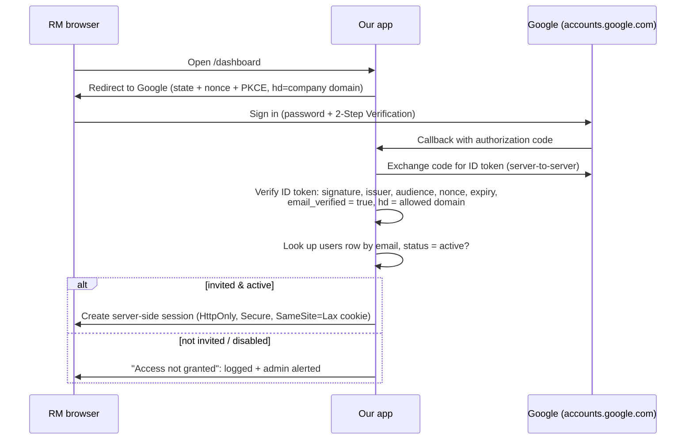
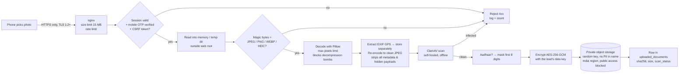

# Security Architecture

*How the CSP onboarding platform protects leads' identity documents, bank details and personal data. Target: **OWASP ASVS Level 2**, plus India-specific rules (DPDP, CERT-In, UIDAI, RBI). Read with [ARCHITECTURE.md](ARCHITECTURE.md).*

---

## 1. What we protect, and from whom

**Assets, most sensitive first:**
1. Aadhaar images and data
2. PAN
3. Bank account details
4. Signatures and declarations
5. Call recordings
6. Names, DOB, addresses, phone numbers
7. RM accounts (each one can see many leads)
8. Encryption keys and secrets

**Threats:**

| Threat | Example | Main defences |
|---|---|---|
| Outsider steals data | SQL injection, exposed bucket, leaked backup | Parameterised queries, private storage, field- and file-level encryption, encrypted backups, WAF |
| Account takeover of an RM | Phished password, stolen laptop session | **Google sign-in only** with Workspace 2-Step Verification, short sessions, revocable sessions, alert on new device |
| Insider over-access | RM browses leads not assigned to them | RBAC + Postgres RLS, every document view audited, unusual-volume alerts |
| Lead impersonation / data hijack | Someone enters another person's mobile on the public form | **OTP-verify the mobile** before linking a form to a lead; a form only ever shows its own session's data |
| Malicious upload | PHP/HTML file disguised as a photo, image-parser exploit, zip bomb | Magic-byte check, re-encode every image, size/pixel limits, antivirus, files never served from the web root |
| Bots / abuse | Spam submissions, scraping | Rate limits per IP and mobile, OTP, payload limits |
| Data leak to third parties | Analytics script, CDN font, SaaS error tracker, AI vendor training on our data | **No third-party scripts on any page**, self-hosted fonts, PII scrubbed from logs, vendors only under a DPA with India residency and no-training terms |
| Tampering / repudiation | Someone edits a record or denies approving a message | Append-only `events`, hash-chained `audit_log`, approvals record who and when |
| Supply chain | Compromised Python package | Pinned and hash-checked dependencies, vulnerability scanning, minimal dependencies |
| Ransomware / server loss | Disk encrypted by attacker | Offline encrypted backups, tested restores, least-privilege server access |

### A note on "never exposed to open source"

Using open-source **software** (PostgreSQL, Flask, ClamAV, nginx) is normal and safe in banking. It runs on **your** server and never receives your data. What actually protects you:

- **Our code stays in a private company repository.** It is never published.
- **No lead data ever leaves our server** except to vendors you have approved in writing (WhatsApp, email, SMS, STT). See §7.
- **Every dependency is pinned and scanned.** Nothing is pulled in unvetted.

---

## 2. Sign-in: Google only, invite-only

- **No passwords stored by us.** Password strength, 2-Step Verification and blocking suspicious logins are Google's job. **Enforce 2-Step Verification** for all RMs in the Google Workspace admin console.
- **Google Cloud OAuth client:** type "Web application". Consent screen **Internal**, so only accounts in your Workspace can even try. Scopes: `openid email profile` only. Library: **Authlib** (handles state, nonce and PKCE).
- **Invite-only:** an admin adds the RM's email in the `users` table. A Google account from the right domain still can't get in without an active invite.
- **Sessions:**
  - stored server-side, with only a hash in the DB
  - 8-hour absolute and 30-minute idle timeout
  - revoked when a user is disabled
  - users can sign out everywhere
  - downloading packets or exporting data needs a sign-in from the last 15 minutes
- **Leads never get accounts.** Their access is their own form session, secured by mobile OTP.

---

## 3. Secure upload pipeline

**Rules:**
- **Compress on the phone first, then check again on the server.**
  - Rural phones take 4–8 MB photos, and uploads fail on weak 4G. The form resizes each photo in the browser to about 1600 px on the long side before uploading.
  - That's large enough that Aadhaar and PAN text stays readable.
  - The server still applies every check below. Browser-side work is only for speed; it isn't a security measure.
- **If Aceware/ESAF insist on an unmasked Aadhaar copy:**
  - Keep it only in a separate, encrypted, short-lived staging area.
  - Include it only in the encrypted packet.
  - Delete it automatically as soon as the BC confirms receipt.
  - Get their requirement in writing first. The default is masked Aadhaar.
- **Never trust the browser.** The file name, extension and `Content-Type` are ignored. The type comes from the file's bytes.
- **Re-encoding is the key defence.** The stored file is a brand-new JPEG made from decoded pixels, so scripts, polyglot files and metadata can't survive.
- **Storage is private:**
  - self-hosted MinIO, or AWS S3 Mumbai with "Block Public Access"
  - never inside the app or web folder
  - never served by nginx directly
- **Viewing a document:**
  1. The RM's request checks their role and lead assignment.
  2. The view is written to `audit_log`.
  3. The app decrypts and streams the file with `Content-Type: image/jpeg`, `X-Content-Type-Options: nosniff`, `Content-Disposition: inline` and `Cache-Control: no-store`.
- **No permanent links.** Signed links expire within minutes.
- **Lead side:** a lead can upload to, and see thumbnails of, *their own* session only. There is no endpoint that lists or downloads other people's files.

---

## 4. Data protection

| Layer | Control |
|---|---|
| **In transit** | HTTPS only (HSTS, TLS 1.2+, A+ on SSL Labs). TLS between app and Postgres, and to object storage. |
| **At rest: disk** | Full-disk encryption (LUKS) on the server and backup disks. |
| **At rest: fields** | PII columns encrypted in the app (AES-256-GCM). **Envelope encryption:** each lead has a data key, wrapped by a master key held in **HashiCorp Vault** (self-hosted) or a cloud KMS. The DB never holds an unwrapped key. |
| **Search** | HMAC blind indexes (separate key) for mobile and PAN lookup. |
| **Aadhaar** | Store `aadhaar_last4` only. Mask images. Signed QR data verified, never the full number. |
| **Key rotation** | Master key rotated yearly (`kek_version`). Data keys re-wrapped, data not re-encrypted. |
| **Erasure** | Delete the lead's data key (crypto-shred), then delete files and rows. |
| **Backups** | Nightly encrypted `pg_dump` + storage sync to a second location in India. **A restore is tested every month.** |
| **Logs** | No PII in application logs: mobile shown as `******3210`, no answers, no tokens. |

---

## 5. Application security (OWASP top 10 coverage)

- **Injection:** every SQL query is parameterised (already the case). Templates auto-escape (Jinja). No `|safe` on user data.
- **Access control:** deny by default. Every route needs a permission check, and RLS is a second wall in the database.
- **CSRF:** tokens on every form and POST (Flask-WTF). Cookies `SameSite=Lax`.
- **Security headers (nginx):**
  - `Content-Security-Policy: default-src 'self'; script-src 'self'; img-src 'self' data: blob:; frame-ancestors 'none'`
  - `Strict-Transport-Security`
  - `X-Content-Type-Options: nosniff`
  - `Referrer-Policy: no-referrer`
  - `Permissions-Policy` allowing only camera/geolocation on the form
- **No third-party code in the browser:** no Google Fonts, analytics or CDN scripts. Fonts and JS are served from our own server.
- **Rate limiting:**
  - form: 30 requests/min per IP
  - OTP: 3 per mobile per 15 min
  - sign-in attempts limited
  - webhook endpoints need an HMAC signature
- **Webhooks in:** HMAC-SHA256 signature over the raw body, 5-minute timestamp window, `webhook-id` idempotency, secrets kept in Vault.
- **Errors:** generic error pages, no stack traces. Errors go to a **self-hosted** tracker (or are scrubbed) and are never sent to SaaS with PII.
- **Secrets:** in Vault or the server's environment. **Never in git.** Secret scanning (gitleaks) blocks commits that contain them.
- **Dependencies:**
  - `pip install --require-hashes` from a lock file
  - `pip-audit` / OSV scan on every build
  - Bandit + Semgrep static analysis
  - Dependabot-style updates, reviewed

---

## 6. Infrastructure

- **Server in India.** Only ports **443** (and 80 → redirect) are open to the internet.
- **Postgres not reachable from the internet.** It listens on localhost or a private network only.
- **SSH:** keys only, no root login, behind the company VPN or a bastion host, with fail2ban.
- **Dashboard** (`/dashboard`) can be limited to the company VPN or office IPs. The public form (`/apply`) stays open.
- **WAF:** nginx + ModSecurity with the OWASP Core Rule Set (self-hosted).
- **Separate environments:** dev / staging / production. **Real lead data never goes into dev or staging.** Use generated test data.
- **App runs as an unprivileged user,** with a read-only code directory and systemd sandboxing (`ProtectSystem=strict`, `NoNewPrivileges`).
- **Clocks** synced by NTP to NIC/NPL servers (CERT-In requirement).

---

## 7. Third parties: what data goes where

| Vendor | Gets | Doesn't get | Requirement |
|---|---|---|---|
| Google (sign-in) | RM email/name | Any lead data | — |
| Meta WhatsApp Cloud API | Lead mobile + message text | Documents, KYC | DPA. Utility templates only. |
| Email provider (SES Mumbai / ZeptoMail) | Lead email + message | Documents | India region, DPA |
| SMS OTP provider | Mobile + OTP | Anything else | DLT-registered template (TRAI) |
| STT (Sarvam) | Call audio | Documents | India processing, no training on our data, deletion terms in writing |
| LLM for call insights | Transcript | Documents, Aadhaar/PAN | Enterprise terms, no training, India/approved region, or self-hosted model |
| KYC aggregator (PAN / penny-drop) | PAN / account number | Photos | RBI-regulated partner, DPA |
| Telegram (RM alerts) | **Lead ID and status only, no names, numbers or documents** | All PII | — |

**Never:** analytics trackers, session-replay tools, public pastebins, AI chatbots fed with lead data, or personal Gmail/Drive.

---

## 8. Monitoring and incident response

- **Alerts to admins on:**
  - sign-in by an uninvited account
  - more than 50 document views by one user in an hour
  - an RM viewing leads outside their assignment (blocked, and alerted)
  - 5xx error spikes
  - antivirus hits
  - a failed backup
- **Log retention:** at least **180 days, stored in India** (CERT-In). Audit log is kept as long as the retention policy says.
- **Incident plan:**
  1. Contain: revoke sessions, rotate keys.
  2. Assess.
  3. **Report to CERT-In within 6 hours** of noticing a reportable incident.
  4. Notify the **Data Protection Board and affected people** without delay, with the detailed report to the Board **within 72 hours** (DPDP Rules 2025).
  5. Inform ESAF/Aceware under contract.
  6. Write a post-mortem.
- Name who is on call, and keep contact numbers for CERT-In, ESAF and Aceware in the runbook.

---

## 9. Compliance map

| Rule | What we do |
|---|---|
| **DPDP Act 2023 + Rules 2025** (full duties from **13 May 2027**; build now) | Unbundled Hindi/English notice + consent checkbox on step 1 of the form, consent records, purpose limitation, retention and deletion, security safeguards (encryption, access control, logs ≥ 1 yr), breach notification (72-hour detailed report), handling access/correction/erasure requests (within 90 days), data processing agreements with ESAF/Aceware and vendors |
| **CERT-In Directions (Apr 2022)** | Report incidents within 6 h, logs 180 days in India, NTP sync |
| **UIDAI / Aadhaar Act** | Never store full Aadhaar numbers, mask images, verify QR signatures, no Aadhaar in logs or file names |
| **RBI BC & outsourcing guidelines** | Bank and RBI can access records, confidentiality, ESAF's retention policy (get it in writing) |
| **TRAI TCCCPR** | DLT-registered SMS templates and sender IDs. Calls via registered numbers. |

---

## 10. Before go-live checklist

- [ ] Google OAuth client (Internal), Workspace 2-Step Verification enforced for all RMs
- [ ] Invite-only users + roles + RLS policies tested, including "RM cannot see another RM's lead"
- [ ] Mobile OTP on the form
- [ ] Upload pipeline: magic bytes, re-encode, ClamAV, Aadhaar masking, private encrypted storage
- [ ] Field-level encryption + Vault/KMS + blind indexes
- [ ] HTTPS A+, security headers, CSP with no third-party sources
- [ ] Rate limits + WAF
- [ ] Backups encrypted + a restore actually tested
- [ ] Log scrubbing verified (grep logs for mobile numbers and names)
- [ ] Dependency + secret scanning in the build
- [ ] **VAPT (penetration test) by a CERT-In empanelled auditor.** Banks usually ask for this report.
- [ ] Data processing agreements with ESAF/Aceware and each vendor; retention policy in writing
- [ ] Incident runbook with contacts

---

## 11. Gaps in today's prototype

The current laptop app is fine for a demo with test data, but **not for real leads' documents** yet:

| Gap | Fixed by |
|---|---|
| Shared dashboard password, no per-user accounts | Google sign-in + `users` + roles |
| Answers and mobile stored as plain text | Field-level encryption |
| Photos on local disk, unencrypted, not re-encoded or scanned | Upload pipeline (§3) |
| Anyone can enter any mobile number on the form | Mobile OTP |
| No CSRF tokens, no security headers, Flask dev server | Flask-WTF, nginx headers, gunicorn |
| HTTP on local WiFi | HTTPS on the company server |
| No audit log of who viewed what | `audit_log` |
| No backups | Encrypted nightly backups |
